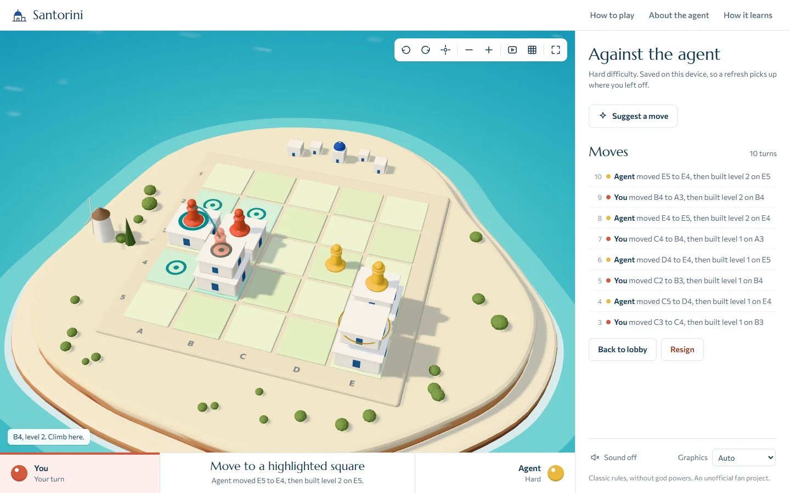
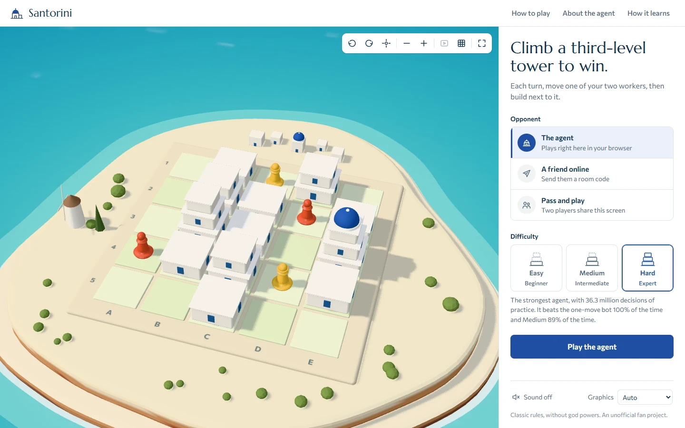
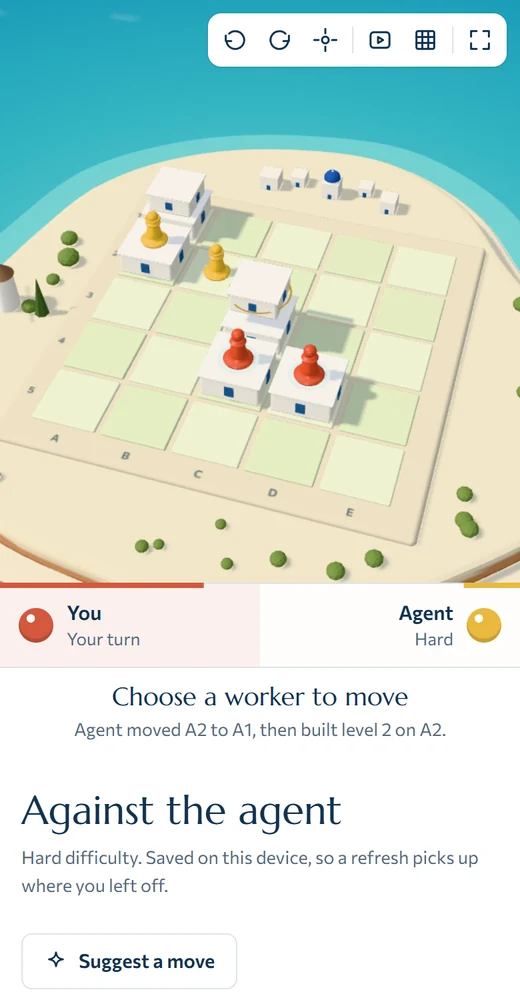
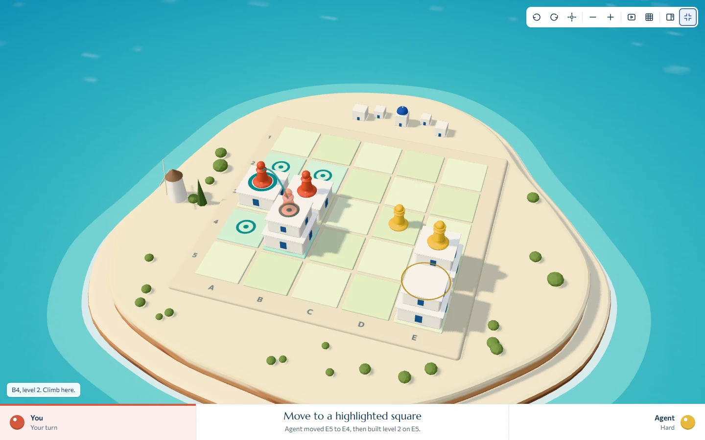
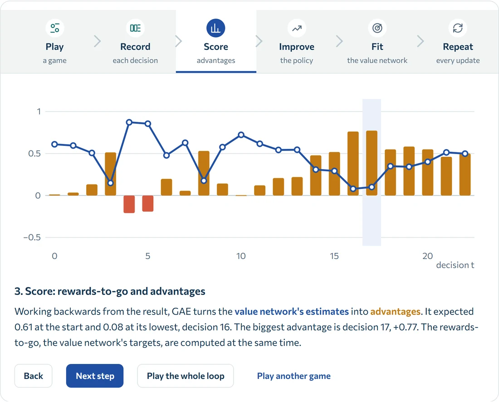
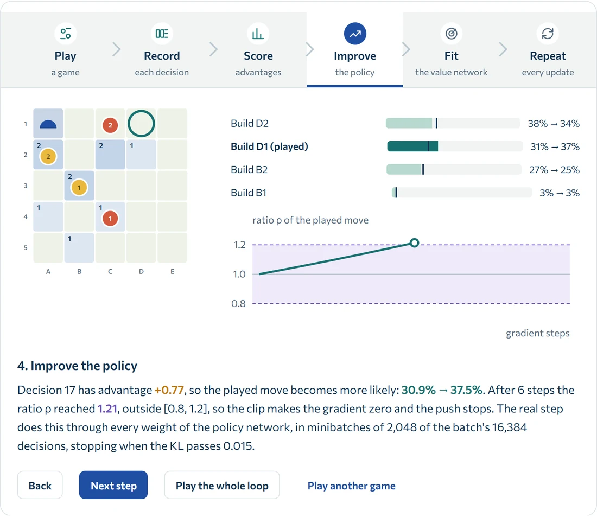
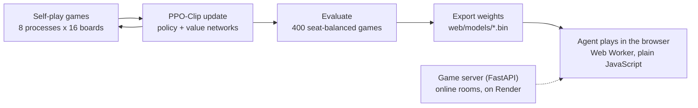

  
# Santorini
[Demo website](https://tanutb.github.io/Santorini/)

Classic Santorini on a 3D island. Play a neural-network opponent trained from scratch with our own PPO-Clip code, pass and play on one screen, or play a friend online.

The agent runs **inside the browser**, so the game can be hosted as plain files on GitHub Pages. Only online games with a friend need the small Python game server, which runs on Render.

> **Note:** some of the code in this project is AI-generated.

<table>
  <tr>
    <td width="64%"> <b>Lobby.</b> Each difficulty says how often it beats the one-move bot and the level below it.</td>
    <td rowspan="2" align="center"> <b>On a phone.</b></td>
  </tr>
  <tr>
    <td> <b>Full screen</b> (F). The moves, coach and settings slide in from the panel button.</td>
  </tr>
</table>

<table>
  <tr>
    <td width="50%"> <b>How it learns: score.</b> GAE turns the value network's estimates into an advantage for each decision of a real training game.</td>
    <td width="50%"> <b>How it learns: improve.</b> The played move becomes more likely until the probability ratio reaches the clip.</td>
  </tr>
</table>

## Run it locally

Python 3.11 or 3.12, from PowerShell:

~~~powershell
python -m venv .venv
.\.venv\Scripts\python.exe -m pip install -r requirements.txt
.\.venv\Scripts\python.exe -m server        # open http://localhost:8000
~~~

- **Another port:** `$env:PORT = 8001` before starting.
- **macOS/Linux:** `.venv/bin/python -m server`.
- **No build step:** the site is plain ES modules in `web/`. Node 22+ is needed only for the tests and the static build.

## How it works

1. **Train** (`server/rl/`). Worker processes play thousands of games at once against random, tactical and one-move-lookahead programs, earlier agents, and frozen copies of the agent itself. Each batch of 16,384 decisions drives one PPO-Clip update, following [OpenAI Spinning Up's](https://spinningup.openai.com/en/latest/algorithms/ppo.html) pseudocode: a policy network learns which moves to make, and a separate value network learns how good positions are.
2. **Evaluate** (`server/rl/arena.py`). A candidate plays 400 games per opponent, half from each seat, with 95% intervals. It is served only after it beats the current agent.
3. **Export** (`scripts/export_models.py`). The PyTorch weights become small binary files. Tests check that the JavaScript network gives the same move probabilities as PyTorch.
4. **Play** (`web/`). The browser evaluates the network in a Web Worker in about 10 ms a move. It samples from the move probabilities, and illegal moves are masked out. Each game it also sees the island from one of its eight rotations and mirror images, so its openings vary.
5. **Deploy.** GitHub Actions publishes the static site to GitHub Pages on every push to `main`. Render runs the game server from `render.yaml`.

**How it learns** (`web/learn.html`, linked from the game's header) teaches the whole process with equations, the real code and interactive figures.

## The agent

| Difficulty | Network and training | Random | Tactician | Lookahead | Head-to-head |
| --- | --- | --- | --- | --- | --- |
| **Hard** | Residual CNN, Spinning Up process, 2.0M games (36.3M decisions) | 100% | 98.8% | 100% | beats Medium 89%, Easy 100%, the previous Hard 78.5% |
| **Medium** | Residual CNN, an early snapshot (1.6M decisions) | 99.8% | 96.8% | 99.8% | beats Easy 100% |
| **Easy** | Small dense network, the first agent (0.45M decisions) | 96.5% | 73.5% | 49.3% | |

Win rates over 400 seat-balanced games each, with the agent sampling its moves as it does in the game. They are against fixed programs, not a rating against people.

The Hard agent's value network died during training: at update 550 all its ReLUs stopped firing, and it predicted the same value for every position. The policy kept improving, with that constant as its baseline. After training, the value network was refit on games played by the frozen final policy (`--refit-value`). The policy, and so every win rate above, is unchanged. The trainer now warns when this happens.

## Train, evaluate and publish an agent

~~~powershell
.\.venv\Scripts\python.exe -m pip install -r requirements-train.txt   # adds PyTorch

# Train until 2M games (snapshots every 100 updates, metrics in training.jsonl):
.\.venv\Scripts\python.exe -m server.rl.train --workers 8 --envs 16 --total-games 2000000 --updates 2500 `
  --final-pi-lr 3e-5 --fixed-opponent checkpoints/previous/ppo.pt --archive-every 100 --output checkpoints/run/ppo.pt

# Compare it with the served agent and the baselines:
.\.venv\Scripts\python.exe -m server.rl.arena checkpoints/run/ppo.pt --against random tactical lookahead checkpoints/ppo.pt --games 400

# Promote: copy it to checkpoints/ppo.pt, then record its evaluation and update the browser's copy:
.\.venv\Scripts\python.exe -m server.rl.evaluate --games 400
.\.venv\Scripts\python.exe scripts/export_models.py          # web/models/*.bin and manifest.json
.\.venv\Scripts\python.exe scripts/make_parity_fixtures.py   # tests/fixtures/parity.json
node scripts/learn-data.mjs checkpoints/run/training.jsonl    # the learning page's training figures
~~~

- `--resume <checkpoint>` continues a run, and adding `--refit-value` trains a fresh value network while the policy stays frozen.
- On Windows each PyTorch process commits about 1.5 GB of memory, so keep `--workers` within what the page file allows.
- Training follows Spinning Up's defaults (γ 0.99, λ 0.97, clip 0.2, value learning rate 1e-3, KL limit 0.01) but takes 4 passes of 2,048-decision minibatches per update; `--minibatch 0` switches to Spinning Up's 80 full-batch steps. The learning page explains every setting.

## Test

~~~powershell
.\.venv\Scripts\python.exe -m pip install -r requirements-dev.txt
.\.venv\Scripts\python.exe -m pytest -q    # rules, online API and security, PPO, trainer, arena
npm run check                              # syntax of every module
npm test                                   # rules and network parity with Python, coach, camera, 2D board
npm run smoke -- http://127.0.0.1:8000     # a real online match over HTTP and WebSockets
~~~

## Deploy

1. **Website (GitHub Pages):** in the repository's Settings > Pages, set Source to GitHub Actions, then push `main`. `.github/workflows/pages.yml` tests, builds (`node scripts/build.mjs`) and publishes the site.
2. **Game server (Render):** on render.com choose New > Blueprint and pick this repository; `render.yaml` sets everything up. Set `SANTORINI_ALLOWED_ORIGINS` to the Pages address, for example `https://<user>.github.io`.
3. **Connect them:** in the GitHub repository, add `SANTORINI_SERVER_URL` with the Render address (Settings > Secrets and variables > Actions, as a secret or a variable), re-run the Pages workflow, and check it with `npm run smoke -- https://<your-server>`.

The free Render plan sleeps after 15 minutes. The site shows "Waking up the game server" while it starts, and the agent and pass and play keep working meanwhile. The server needs only `requirements.txt` (no PyTorch), so any host that keeps one Python process running with WebSockets also works.

| Server setting | Default | Purpose |
| --- | --- | --- |
| `SANTORINI_ALLOWED_ORIGINS` | none | Other sites allowed to use the server (CORS and WebSocket origin check) |
| `SANTORINI_API_KEYS` | none | Comma-separated keys; when set, the API requires `X-API-Key` |
| `SANTORINI_TRUST_PROXY` | off | `1` behind a hosting proxy, so rate limits see real client IPs |
| `PORT` / `HOST` | 8000 / 0.0.0.0 | Listening address |
| `SANTORINI_DB` | data/rooms.sqlite3 | Room database |
| `SANTORINI_RATE_LIMITS` | on | `off` disables rate limits |
| `SANTORINI_MAX_ROOMS` | 10000 | Saved-room capacity |
| `SANTORINI_API_DOCS` | off | `1` publishes `/docs` |

**Security, on by default:**

- Rate limits per IP.
- 4 KB caps on requests and WebSocket messages.
- Socket caps per IP and per room.
- Per-seat tokens, stored only as hashes.
- A strict Content-Security-Policy and other security headers.
- An origin allowlist.

An API key sent by a public page can be read by anyone, so treat it as a speed bump, not a password.

## Project map

| Path | What it holds |
| --- | --- |
| `web/` | The website: lobby and play (`app.js`), rules engine (`engine.js`), 3D board (`three-board.js`), agent (`policy.js`, `agent-*.js`, `models/`), learning page (`learn.*`) |
| `server/game.py` | The authoritative rules and the board encoding the networks read |
| `server/app.py`, `server/security.py` | Online rooms over HTTP and WebSockets, rate limits and security headers |
| `server/rl/` | Networks, PPO, parallel training, baseline opponents, arena |
| `scripts/` | Model export, parity fixtures, static build, smoke test, learning-page generators |
| `tests/` | Python and JavaScript tests |
